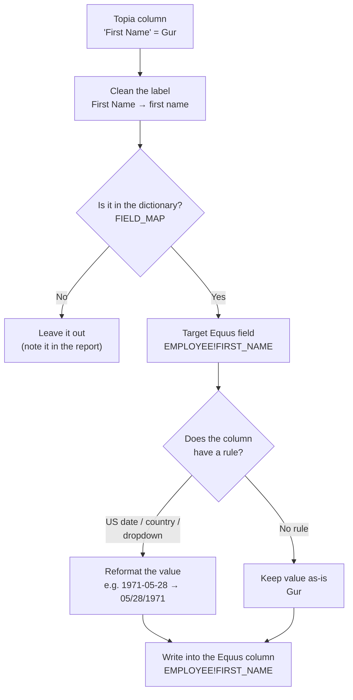
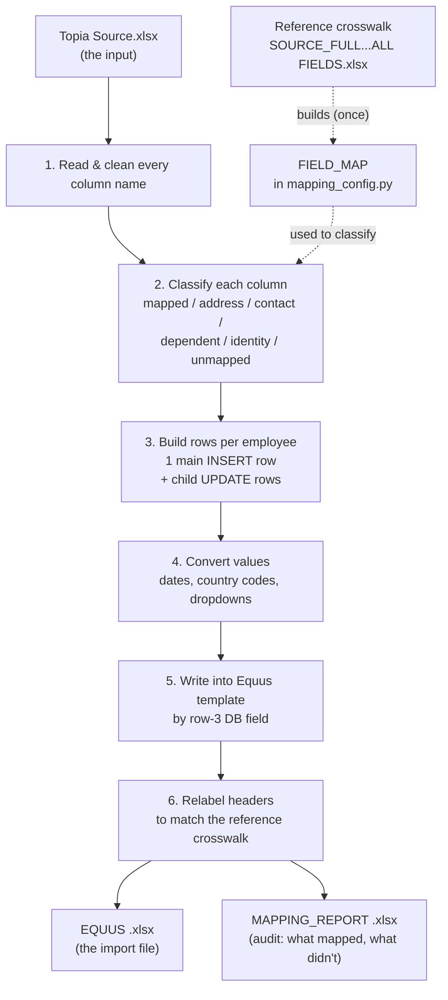
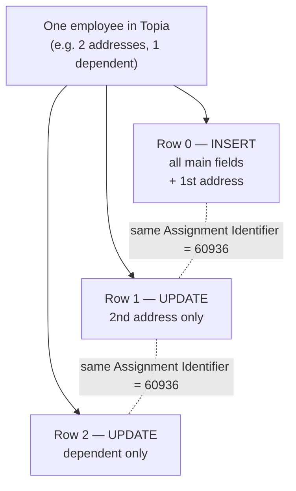

# Mapping Guide — How Topia fields become the Equus EAFH file

This document explains, with concrete examples, **how `lambda/src/mapping_config.py`
connects a Topia field to an Equus field**, how that mapping was derived from
`SOURCE_FULL HISTORICAL PAST ASSIGNMENT ALL FIELDS.xlsx`, and how the final
Equus destination workbook is built.

It is meant to be readable by a functional reviewer, not only a developer.

> **New to this?** Read **§0 (Plain-English)** first — it explains the whole idea
> with two real fields and no jargon. The later sections are the detailed reference.

---

## 0. Plain-English explanation (start here)

### The big idea — it's a translation dictionary

Think of it like translating a form from one language to another.

- **Topia** is the form in "Topia language." It calls a column `First Name`.
- **Equus** is the same form in "Equus language." It calls that same thing
  `EMPLOYEE!FIRST_NAME`.
- `mapping_config.py` is the **translation dictionary** that says: *"When you see
  `First Name` in Topia, write it down as `EMPLOYEE!FIRST_NAME` in Equus."*

That's the whole concept. The dictionary (called `FIELD_MAP`) is just one long
list of these "this = that" pairs.

### Example 1 — First Name (the simple case)

In the Topia file there is a column:

```
First Name
----------
Gur          ← the person's actual value
```

1. **Clean up the label.** The program tidies `First Name` → `first name`
   (lowercase, spaces trimmed). Why? So `First Name`, `FIRST NAME` and
   `first  name` are all treated as the same thing — it's forgiving of messy
   capitals and spacing.
2. **Look it up in the dictionary.** In `mapping_config.py` it finds:
   ```python
   'first name':  'EMPLOYEE!FIRST_NAME',
   ```
   Read it out loud: *"first name becomes EMPLOYEE!FIRST_NAME."*
3. **Find the destination.** The blank Equus template has a column labeled
   `EMPLOYEE!FIRST_NAME`. That's the mailbox. The program drops `Gur` into it.

Done — `Gur` moved from Topia's "First Name" column into Equus's
"EMPLOYEE!FIRST_NAME" column. The value itself wasn't changed, just moved to the
right place.

### Example 2 — Date of Birth (shows why it's not always plain copy-paste)

Sometimes the value must be **reformatted**, not just moved. Dates are the classic
case.

```
Date of Birth
-------------
1971-05-28        ← year-month-day order
```

1. **Clean the label:** `Date of Birth` → `date of birth`.
2. **Dictionary lookup:**
   ```python
   'date of birth':  'EMPLOYEE!BIRTH_DATE',
   ```
   So it's heading for the Equus `EMPLOYEE!BIRTH_DATE` column.
3. **Check the rule.** Above that column the Equus template has an instruction:
   **"US Date Format."** Equus is American, so it wants **month/day/year**.
   The program converts:
   ```
   1971-05-28   →   05/28/1971
   ```
4. **Drop it in.** `05/28/1971` goes into `EMPLOYEE!BIRTH_DATE`.

Same idea as First Name, but with one format translation in the middle because the
column's rule asked for it. (Country columns work the same way: the rule says "use
the country code," so `United States` → `USA`.)

### Putting it together

For each person the program repeats this for every column: **clean the label →
look it up in the dictionary → reformat if the rule says so → drop it in the
matching Equus column.**

| Topia column | Value in | Dictionary says | Rule | Value out | Equus column |
|---|---|---|---|---|---|
| First Name | `Gur` | → `EMPLOYEE!FIRST_NAME` | *(none)* | `Gur` | `EMPLOYEE!FIRST_NAME` |
| Date of Birth | `1971-05-28` | → `EMPLOYEE!BIRTH_DATE` | US date | `05/28/1971` | `EMPLOYEE!BIRTH_DATE` |

**Four things to remember:**

1. The dictionary (`FIELD_MAP`) is just a list of "Topia name = Equus name" pairs —
   that is the heart of the mapping.
2. Matching is done by the column's **name**, not its position, so reordering the
   Topia columns changes nothing.
3. Most fields are a straight move; some get **reformatted** (dates, country names,
   Yes/No, dropdowns) based on a rule written in the Equus template.
4. If a Topia column isn't in the dictionary, it is **left out and noted in a
   report** — nothing disappears silently.

### Flow diagram — one field's journey

How a single value (e.g. `Gur`) travels from a Topia column to an Equus column:



### Flow diagram — the whole file, start to finish



### Flow diagram — why one person can become several rows

Extra addresses, contacts and dependents each become their own `UPDATE` row,
linked back to the main row by the **Assignment Identifier**:



---

## 1. The three spreadsheets involved

Everything revolves around three Excel files, each with a *different* row layout.
Understanding these rows is the key to understanding the whole mapping.

### a) Topia Source — the input (`Topia Source.xlsx`)

| Row | Meaning | Example |
|-----|---------|---------|
| Row 1 | **Topia field name** (header) | `First Name`, `Employee ID`, `Date of Birth` |
| Row 2+ | One employee/assignment per row | `Gur`, `60936`, `1971-05-28` |

### b) Reference crosswalk — the "dictionary" (`SOURCE_FULL HISTORICAL PAST ASSIGNMENT ALL FIELDS.xlsx`)

This is the **human-approved map** between the two systems. One column per Equus
field, stacked like this:

| Row | Meaning | Example (column for First Name) |
|-----|---------|---------------------------------|
| Row 1 | Instruction / rule | *(blank or e.g. "US Date Format")* |
| Row 2 | **EAFH Column Header** = the Equus **DB field** | `EMPLOYEE!FIRST_NAME` |
| Row 3 | EP Field Name = the Equus **UI label** | `First Name` |
| Row 4 | **Topia field name** | `First Name` |
| Row 5+ | Sample data | `Gur` |

So in the reference file, **row 4 (Topia) sits directly above row 2 (Equus DB field)**
in the same column. That vertical pairing *is* the mapping:

```
Reference column C (example):
   Row 2  EMPLOYEE!FIRST_NAME     ← Equus DB field
   Row 3  First Name              ← Equus UI label
   Row 4  First Name              ← Topia field   ──┐
                                                    │  this pairing →
   FIELD_MAP['first name'] = 'EMPLOYEE!FIRST_NAME' ─┘  becomes one line in mapping_config.py
```

`local/build_field_map.py` reads that pairing for every column and emits the
`FIELD_MAP` dictionary you see in `mapping_config.py`. (It was then hand-reviewed
and a few approved overrides were baked in.)

### c) Equus template — the output skeleton (`lambda/src/templates/equus_template.xlsx`)

Sheet name: `" Mny dependents Ex"` (note the leading space). Header rows only, no data:

| Row | Meaning | Example (Gender column) |
|-----|---------|-------------------------|
| Row 1 | Instruction / conversion rule | `Match dropdown` |
| Row 2 | UI label | `Gender` |
| Row 3 | **DB field** (this is what the code writes by) | `EMPLOYEE!GENDER` |
| Row 4+ | Data gets written here | *(filled by the Lambda)* |

> **Important:** the code always places values by the **row-3 DB field**, never by
> the row-2 UI label. In some areas the UI labels are offset by one column, so the
> DB field is the only reliable anchor.

---

## 2. What lives in `mapping_config.py`

`mapping_config.py` is the single place a reviewer edits. It is pure data — no
logic. Here are the pieces and what each one does.

### FIELD_MAP — the core 1-to-1 map
`{ normalised Topia header → Equus DB field }`

```python
FIELD_MAP = {
    'first name':     'EMPLOYEE!FIRST_NAME',
    'date of birth':  'EMPLOYEE!BIRTH_DATE',
    'gender':         'EMPLOYEE!GENDER',
    'nationality 1':  'EMPLOYEE_CF!CF_TEXT002',
    'home country':   'ASSIGNMENT!FROM_COUNTRY',
    'home entity':    'ASSIGNMENT!FROM_COMPANY_SEGMENT_LEVEL_1',
    ...
}
```
"Normalised" means: whitespace collapsed, trimmed, lower-cased (see §3). So the
Topia header `"First Name"`, `" first  name "` and `"FIRST NAME"` all resolve to
the same key `first name`.

### HEADER_MAP — how the output headers get relabeled
`{ Equus DB field written by the code → (DB field as reference wants it, UI label, rule) }`

After the data is placed, the output's header rows are rewritten to match the
reference file. Example:

```python
'ASSIGNMENT!FROM_COMPANY_SEGMENT_LEVEL_1':
    ('ASSIGNMENT!FROM_COMPANY_LEVEL1', 'From Legal Entity', 'Match dropdown list'),
```
This means: *data is written into the template column whose row-3 DB field is
`ASSIGNMENT!FROM_COMPANY_SEGMENT_LEVEL_1`, then that header is relabeled to
`ASSIGNMENT!FROM_COMPANY_LEVEL1` with UI label `From Legal Entity`.* Controlled by
the switches `RELABEL_HEADERS_FROM_REFERENCE` and `RELABEL_DB_FIELDS` (both `True`).

### Identity / control columns
These are not ordinary mapped fields — they drive how Equus inserts rows:

| Equus control column | Source | Config key |
|----------------------|--------|-----------|
| `Employee Number` | Topia **Employee ID** (Talent Link ID) | `EMPLOYEE_NUMBER_SOURCE = "employee id"` |
| `Assignment Identifier` | Topia **Topia ID** | `ASSIGNMENT_IDENTIFIER_SOURCE = "topia id"` |
| `Assignment Number` | literal `NEW` | `NEW_ASSIGNMENT_NUMBER` |
| `Employee Command` | `INSERT` first time an employee appears, else `IGNORE` | `EMPLOYEE_COMMAND_*` |
| `Assignment Command` | `INSERT` on the main row, `UPDATE` on child rows | `ASSIGNMENT_COMMAND_*` |

### Special-shape maps (one Topia value → a *child* row, not a cell)
- **`ADDRESS_COLUMNS`** — each non-empty address column becomes one address
  child row (`ASSIGNMENT_MAILING_ADDRESS!…`) with a fixed `LOCATION_TYPE`.
- **`CONTACT_COLUMNS`** — phone/mobile become contact child rows
  (`ASSIGNMENT_EMPLOYEE_CONTACT!…`) with a `LOCATION_TYPE` / `CONTACT_TYPE`.
- **`DEPENDENT_FIELD_MAP`** + `DEPENDENT_HEADER_RE` — columns named like
  `"Child 1 First Name"`, `"Dependent 2 Gender"` become dependent child rows
  (`ASSIGNMENT_DEPENDENT!…`).

### Value translation tables
- **`SOURCE_ALIASES`** — documented renames of *input* headers across Topia
  extract versions (e.g. `"e-mail" → "email"`, `"talent link id" → "employee id"`).
- **`VALUE_MAPS`** — dropdown value translations keyed by Equus field
  (e.g. `EMPLOYEE!EMPLOYMENT_STATUS`: `"employed" → "Active"`).
- **`COUNTRY_ISO3`** — country name → ISO-3 code (`"United States" → "USA"`), used
  for any column whose rule says "Match Country Code".
- **`RESOURCE_MAP`** — Topia person name/email → Equus username (currently empty;
  unmatched values pass through and are reported).
- **`BLANK_TOKENS`** — input values treated as empty (`"not provided"`, `"n/a"`, …).

### Exclusions
- **`EXCLUDE_FIELDS`** — normalised Topia headers to never migrate (add one line
  to drop a column; no code change).
- **`IGNORED_LABEL_PREFIXES`** — descriptor columns like `"Location Type - …"`
  that only label the address constants.

---

## 3. How a value flows from Topia to Equus (the pipeline)

`transform.py` runs these steps. No step depends on a fixed Excel column number —
columns are found by name, so reordered/extra/missing columns are handled and
reported.

```
Topia Source.xlsx
   │ 1. build_source_index   read row 1, normalise every header
   │ 2. build_column_plan    classify each column (mapped? address? dependent? …)
   │ 3. build_records        per employee row: build main row + child rows, set commands
   │ 4. convert              format each value (dates, country codes, dropdowns)
   │ 5. write_output         write values into the template by row-3 DB field
   │ 6. relabel_headers      rewrite output header rows to match the reference file
   ▼
<name>_EQUUS_<timestamp>.xlsx   (+ a _MAPPING_REPORT_ file)
```

**Classification precedence** in step 2 (first match wins): excluded → address →
contact → ignored-label → cancellation-rule → dependent → identity → `FIELD_MAP`
→ otherwise *unmapped* (reported, not an error).

**Conversion rules** in step 4 are driven by the template's row-1 text and the DB
field name:
- row-1 says "…Date Format" or field ends in `_DATE` → parse and format as `MM/DD/YYYY`
- row-1 says "…Country Code" or field ends in `_COUNTRY`/`_CITIZENSHIP` → `COUNTRY_ISO3`
- row-1 says "dropdown"/"yesno" or field has `RESOURCE` → apply `VALUE_MAPS` / `RESOURCE_MAP`, and log the value sent

---

## 4. Worked example — one employee, end to end

Take the first Topia Source row:

| Topia field (row 1) | Value |
|---------------------|-------|
| Employee ID | `60936` |
| Topia ID | *(blank)* |
| First Name | `Gur` |
| Last Name | `RAJ` |
| Gender | `Male` |
| Date of Birth | `1971-05-28` |
| Nationality 1 | `Indian` |
| Home Country | `United States` |
| Home Entity | `Acme US Inc` |

Here is what the code does with each:

| Topia field | Normalised key | FIELD_MAP / rule → Equus DB field | Conversion | Lands in template col (row-3 DB) | After relabel (row 2 / row 3) |
|-------------|----------------|-----------------------------------|------------|----------------------------------|-------------------------------|
| Employee ID `60936` | `employee id` | **identity** → `Employee Number` control col | integer `60936` | col 3 | `Talent Link Id` / `Employee Number` |
| Topia ID *(blank)* | `topia id` | identity → `Assignment Identifier`; blank ⇒ **falls back to Employee Number** (warned) | `60936` | col 5 | `Topia Id` / `Assignment Identifier` |
| First Name `Gur` | `first name` | `EMPLOYEE!FIRST_NAME` | text | col 6 | `First Name` / `EMPLOYEE!FIRST_NAME` |
| Gender `Male` | `gender` | `EMPLOYEE!GENDER` (rule *Match dropdown*) | logged as dropdown value | col 11 | `Gender` / `EMPLOYEE!GENDER` |
| Date of Birth `1971-05-28` | `date of birth` | `EMPLOYEE!BIRTH_DATE` (rule *US Date Format*) | → `05/28/1971` | col 12 | `Birth Date` / `EMPLOYEE!BIRTH_DATE` |
| Nationality 1 `Indian` | `nationality 1` | `EMPLOYEE_CF!CF_TEXT002` | text | col 14 | `Primary Nationality` / `EMPLOYEE_CF!CF_TEXT002` |
| Home Country `United States` | `home country` | `ASSIGNMENT!FROM_COUNTRY` (rule *Match Country Code*) | → `USA` | col 34 | `Home Country` / `ASSIGNMENT!FROM_COUNTRY` |
| Home Entity `Acme US Inc` | `home entity` | `ASSIGNMENT!FROM_COMPANY_SEGMENT_LEVEL_1` | text | col 50 | `From Legal Entity` / `ASSIGNMENT!FROM_COMPANY_LEVEL1` |

The last row is the clearest illustration of the two-stage mechanism:
1. **Placement:** `FIELD_MAP['home entity']` → `ASSIGNMENT!FROM_COMPANY_SEGMENT_LEVEL_1`,
   and that is the DB field in template row-3 col 50, so the value is written there.
2. **Relabel:** `HEADER_MAP['ASSIGNMENT!FROM_COMPANY_SEGMENT_LEVEL_1']` rewrites that
   column's header to `ASSIGNMENT!FROM_COMPANY_LEVEL1` with UI `From Legal Entity`,
   matching the reference file exactly.

### The resulting output rows

For this employee with no extra addresses/contacts/dependents, the output is a
single row:

| Employee Command | Assignment Command | Employee Number | Assignment Number | Assignment Identifier | …FIRST_NAME | …BIRTH_DATE | …FROM_COUNTRY | … |
|---|---|---|---|---|---|---|---|---|
| `INSERT` | `INSERT` | `60936` | `NEW` | `60936` | `Gur` | `05/28/1971` | `USA` | … |

If the same employee had, say, two addresses and one dependent, you would get
**one `INSERT` row** (the main assignment) plus **`UPDATE` child rows** — one per
extra address/contact/dependent — all sharing the same `Assignment Identifier`
(`60936`) so Equus links them to the assignment:

| # | Employee Command | Assignment Command | Assignment Identifier | What the row carries |
|---|---|---|---|---|
| 0 | `INSERT` | `INSERT` | `60936` | all mapped main fields + 1st address/contact/dependent |
| 1 | `IGNORE` | `UPDATE` | `60936` | 2nd address child record only |
| 2 | `IGNORE` | `UPDATE` | `60936` | dependent child record only |

(`Employee Command` is `INSERT` only the **first** time an employee number appears
across the whole file; every later row for the same person is `IGNORE`.)

---

## 5. How the destination file is created (step 5–6 in detail)

In `transform.write_output`:

1. Load the bundled template (`lambda/src/templates/equus_template.xlsx`).
2. Read its row-3 DB fields into a `{DB field → column index}` map.
3. Clear any existing data rows (row 4 downward).
4. For each built record, for each `DB field → value`, look up the column by DB
   field and write the value at the next data row. Dates get the `MM/DD/YYYY`
   number format. A value whose DB field is not in the template is **dropped and
   reported** (never silently lost).
5. `relabel_headers_from_reference` rewrites rows 1–3 of each column that appears
   in `HEADER_MAP`, so the finished file's headers match the reference crosswalk.

`handler.py` then writes two files to the destination bucket:

| File | Content |
|------|---------|
| `equus/<name>_EQUUS_<timestamp>.xlsx` | the Equus import workbook above |
| `equus/reports/<name>_MAPPING_REPORT_<timestamp>.xlsx` | the audit report (below) |

### The mapping report (how to verify a run)
Five sheets, produced every run:
- **Column Mapping** — every Topia column: its status (mapped / address / … /
  unmapped), the Equus DB field it hit, the output column, UI label and rule.
- **Equus Coverage** — every Equus column: how many cells were populated and from
  which source column(s).
- **Dropdown Values** — each distinct value sent to a dropdown/resource field, so
  reviewers can confirm they match Equus' picklists.
- **Warnings** — unparseable dates, country names with no ISO-3 code, missing keys,
  address free-text, etc.
- **Summary** — counts per status, assignments read, rows written, warnings.

---

## 6. Common changes (and the one line to change)

| I want to… | Edit in `mapping_config.py` |
|------------|------------------------------|
| Stop migrating a Topia column | add its normalised name to `EXCLUDE_FIELDS` |
| Remap a Topia field to a different Equus field | change its value in `FIELD_MAP` |
| Add a field that a new Topia extract includes | add a `FIELD_MAP` line (+ `HEADER_MAP` if the header should be relabeled) |
| Handle a renamed input header | add it to `SOURCE_ALIASES` |
| Translate a dropdown value | add it to `VALUE_MAPS` under the Equus DB field |
| Provide Equus usernames for resource fields | fill `RESOURCE_MAP` |
| Change which Topia column is the identity key | change `EMPLOYEE_NUMBER_SOURCE` / `ASSIGNMENT_IDENTIFIER_SOURCE` |

To regenerate the whole `FIELD_MAP` baseline from the reference crosswalk after it
changes, run `python local/build_field_map.py`.

---

### One-line summary
`FIELD_MAP` turns each **Topia header** into an **Equus DB field**; the transformer
writes values into the template **by that DB field (row 3)**, converts them per the
template's **row-1 rules**, splits addresses/contacts/dependents into **`UPDATE`
child rows**, and finally **relabels the headers** to match
`SOURCE_FULL HISTORICAL PAST ASSIGNMENT ALL FIELDS.xlsx` — the approved crosswalk
the map was built from.
